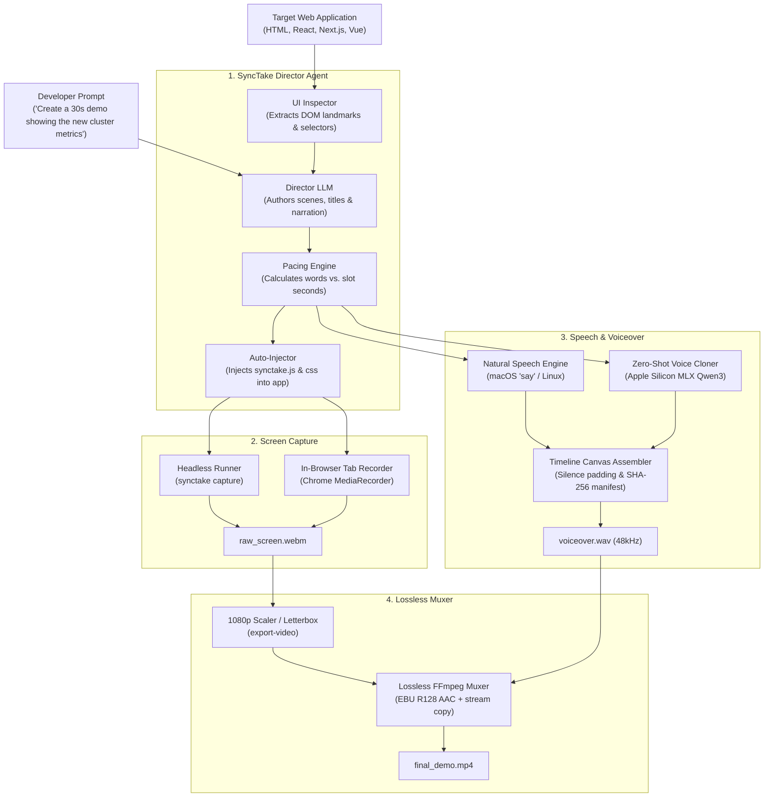

<div align="center">

# 🎬 SyncTake

### **Agent-First Walkthrough-as-Code**
*Turn code, UI, and user guidance into perfectly synchronized, narrated product demo videos with zero audio drift.*

[](LICENSE)
[](https://www.python.org/downloads/)
[]()
[]()

</div>

---

## 💡 Why SyncTake?

Recording software demos and product walkthroughs is notoriously frustrating:
- **Talking while clicking:** Stumbling over a word, coughing, or clicking the wrong button ruins a 4-minute take.
- **Audio/Video desync:** Recording voiceover separately requires hours in Premiere, Final Cut, or CapCut manually cutting, trimming, and dragging audio clips to match on-screen actions.
- **Fragile re-takes:** If a single UI button or feature changes, the entire video must be recorded and edited again from scratch.

**SyncTake solves this by treating walkthroughs as code, directed by AI coding agents:**
1. **Agent-First UI Understanding:** An AI coding agent inspects your codebase and DOM landmarks (`#hero`, `[data-testid='metric-card']`, `.cta-btn`).
2. **Paced Script Synthesis:** Automatically authors conversational narration paced at **~145 words per minute** (~2.4 words/second) so speech fits each scene window naturally.
3. **Host-Adaptive Design System:** The client overlay automatically samples your app's background, luminance, brand colors, borders, and typography so callouts look completely native to your app.
4. **Deterministic Zero Audio Drift:** Pauses are padded with digital silence; clips are verified against slot durations; SHA-256 hashes guarantee your audio can never drift from screen cues.
5. **Real Voice & Zero-Shot Cloning:** Synthesizes clear spoken English out of the box, with support for local Apple Silicon MLX zero-shot voice cloning from a 10-second reference audio sample.
6. **Automated & Interactive Capture:** Record silently via headless Playwright or an interactive in-browser tab recorder, then losslessly mux into 1080p MP4.

---

## 🏗️ Architecture



---

## 🛠️ Quickstart

### 1. Installation

```bash
# Clone the repository
git clone https://github.com/arvind1705/synctake.git
cd synctake

# Install in development mode
pip install -e .

# Optional: Apple Silicon local zero-shot voice cloning (Qwen3-TTS via MLX)
pip install -e ".[mlx]"

# Optional: Automated headless capture (Playwright)
pip install playwright && playwright install chromium
```

---

### 2. Install Skill for Your Coding Agent

SyncTake is built to work seamlessly with **Claude Code**, **Cursor**, **Antigravity**, **OpenCode**, and **Codex**:

```bash
# In your target web app directory:
synctake skill --framework all
```

This installs the universal skill into:
- `.agents/skills/synctake/SKILL.md` (Antigravity & Agent standard)
- `.claude/skills/synctake/SKILL.md` (Claude Code)
- `.cursor/rules/synctake.mdc` (Cursor IDE)

Now you can simply tell your coding agent:
> *"Record a 30-second walkthrough video of this feature and save the demo video."*

---

### 3. Step-by-Step CLI Usage

#### Step A: Let the Agent Plan Your Walkthrough
```bash
synctake plan ./public/index.html \
  --prompt "Make an executive 30-second walkthrough highlighting live metrics and the deploy button" \
  --duration 30 \
  --inject
```
*The agent inspects `index.html`, identifies landmarks like `#metrics` and `#deploy-btn`, authors the script, balances speech pacing, and injects `synctake.js` before `</body>`.*

#### Step B: Capture the Screen Recording
**Option 1: Fully Automated (Playwright)**
```bash
synctake capture --url http://localhost:3000 --config synctake.json --out build/capture.webm
```

**Option 2: Interactive in Chrome**
1. Open your web app in Chrome (e.g. `http://localhost:3000`).
2. Click **Record Take** on the floating widget.
3. Select the browser tab in Chrome's screen-sharing prompt.
4. The tour will smoothly scroll to target elements, display animated callouts, and automatically download `synctake-take.webm` when the duration is reached.

#### Step C: Synthesize & Assemble Voiceover
```bash
# Real natural voiceover (out of the box):
synctake voice synctake.json --out build/voice

# In your own cloned voice (10s audio reference):
synctake voice synctake.json --ref-audio ./my-voice.wav --out build/voice

# Fast synthetic test tone (for CI / testing):
synctake voice synctake.json --mock --out build/voice
```

#### Step D: Lossless Mux into Final 1080p MP4
```bash
# 1. Convert WebM to 1080p 30fps H.264
synctake export-video build/capture.webm synctake.json --out build/visual.mp4

# 2. Losslessly mux with normalized AAC audio (-16 LUFS)
synctake combine build/visual.mp4 build/voice/voiceover.wav synctake.json --out demo.mp4
```

---

## 🎨 Host-Adaptive Design System

When injected into a web app, SyncTake dynamically samples the host document's styles:
- **Background & Luminance:** Automatically adapts to Light Mode or Dark Mode.
- **Brand Colors:** Samples `.brand`, `header`, or primary buttons to match your brand accent.
- **Borders & Shadows:** Adopts the host app's card borders and elevations.
- **Typography:** Uses the host font family (`system-ui`, Inter, etc.).
- **Focus Rings:** Replaces generic outlines with a subtle, brand-matching focus ring.

---

## 📋 Walkthrough Specification (`synctake.json`)

```json
{
  "title": "Cloud Dashboard Demo",
  "duration_seconds": 30.0,
  "voice": {
    "provider": "system",
    "reference_audio": "./voice-reference.wav"
  },
  "scenes": [
    {
      "id": "01-overview",
      "at": 0.0,
      "title": "Live Cluster Overview",
      "callout": "Real-time health and telemetry metrics across regions",
      "focus": "#cluster-overview",
      "text": "Welcome! In this walkthrough, we will explore real-time cluster health and automated remediation."
    },
    {
      "id": "02-actions",
      "at": 12.5,
      "title": "One-Click Deployments",
      "callout": "Automated validation with human approval",
      "focus": "#deploy-btn",
      "text": "With a single click, our pipeline validates configuration changes and applies rolling updates."
    }
  ]
}
```

---

## 🔒 Guaranteed Zero Audio Drift

SyncTake enforces hard mathematical constraints:
- **Slot Allocation Validation:** Speech length is measured and compared against the allocated scene duration. If speech overruns, SyncTake warns you with the exact second overrun so text can be trimmed.
- **Digital Silence Padding:** Interstitial pauses are padded with calibrated silence. Scene $N$ will start at *exactly* its specified millisecond cue regardless of minor variations in previous scenes.
- **SHA-256 Fingerprinting:** The combiner validates cryptographic hashes of the config and timing manifest to ensure video and audio were produced from the identical script.

---

## 📄 License

MIT License. Open-source and developer-first. Built for the coding agent era!
